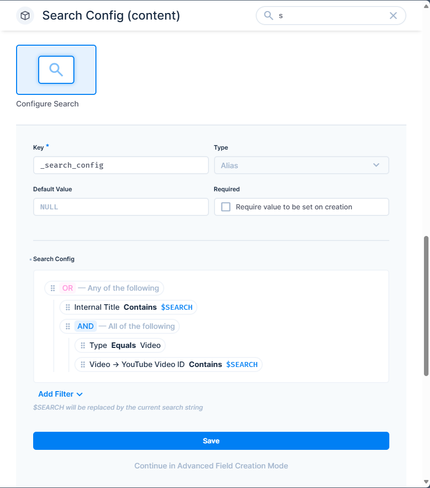

# Search Configuration for Directus

Provides a way to configure the Directus search filters for a collection. This allows you to supercharge your Directus `search` field with AND/OR groups, strict equality, case-insensitive searches, and nested relational searches, fully under your control.

# Installation

This plugin has not yet been published on NPM, but you can try installing it directly from GitHub.

# Usage

1. Add a new field named `_search_config` in the collection you with to add search configuration for.

   > **The field must have the key `_search_config` at the moment. In the future we might add a way to configure this.**

2. Configure your filter in the `Search Config` interface options. Use `$SEARCH` as a placeholder for the user's search query.

Search the collection. Both app and API searches will now use the filter pattern you've specified. You can use nested relational fields for the search.

# Text filters on SQLite (`text-filter-offload`)

On SQLite, Directus runs every query on one pooled connection. A `Contains`
filter on a large text field (an article body, say) reads every row, and while
it runs every other request waits; waits over ten seconds fail.

This hook takes those filters off the pooled connection. For a list request
(`GET` or `SEARCH /items/:collection`) whose filter has `_contains` or
`_icontains` on a field of type `text`, it finds the matching primary keys on
a separate read-only connection and hands Directus `id IN (…)` instead. The
list and its count are both covered. Scans run one at a time, and a scan whose
client has gone away (the admin app abandons a request per keystroke) is
skipped or interrupted.

It does nothing on other databases, and passes the request through untouched
when the database is not in WAL mode, the caller may not filter on the field,
more keys match than the cap, or anything fails.

| Variable                      | Default | Purpose                                                   |
| ----------------------------- | ------- | --------------------------------------------------------- |
| `TEXT_FILTER_OFFLOAD_ENABLED` | `true`  | Set to `false` to switch the hook off.                    |
| `TEXT_FILTER_OFFLOAD_MAX_IDS` | `20000` | Most keys one request may hand to Directus (max `30000`). |

The middleware is mounted when Directus starts, so a rebuilt bundle needs a
restart to take effect (extension auto-reload does not remount it).
